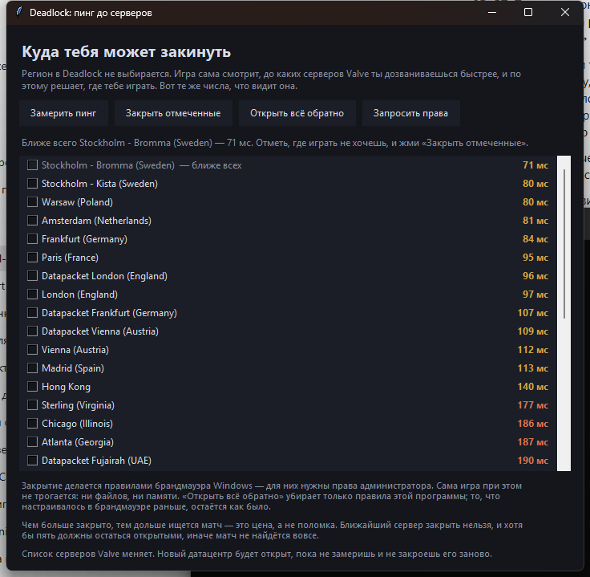

# deadlock_lobby_fix

Measure your real ping to every Valve relay Deadlock matchmaking uses — and,
if you want, close the ones you do not want to be sent to.

*Русская версия — [ниже](#deadlock_lobby_fix-по-русски).*



---

## Why this exists

Deadlock has **no region picker**, and that is not a missing button. The game
decides where to put you from the latency it measures to Steam Datagram Relay
nodes. The game's own localisation file says so outright:

```
Citadel_StartMatchmaking_NoRegionPings
    "Unable to communicate with any Steam Datagram Relay..."
```

There is no "Europe only" switch anywhere — not in the settings, not in the
interface strings. `Citadel_Region_*` labels leaderboards;
`Citadel_PrivateLobby_Region_Unselected` is about private lobbies.

So there are two honest things a tool can do here:

1. **Show the same numbers matchmaking sees.** Your real ping to each
   cluster. This answers "why do I keep getting thrown to Virginia" far better
   than any forum thread — and it also separates two problems that look
   identical from the inside. If your neighbour gets 70 ms to Stockholm and you
   get 140 ms, that is your ISP's routing, and routing can be fixed. Without a
   measurement you cannot tell that apart from "the game is bad".

2. **Close the clusters you do not want.** What the client cannot reach does
   not exist for matchmaking, so it will not send you there.

On the machine this was measured on the nearest relay is 68 ms (Stockholm). Valve
has **no clusters in Russia at all**, which explains the complaint better than
any advice: even the best case is far, and when the European queue has nobody
to match you with, matchmaking widens the search — 180 ms to Virginia looks
like a fair price to it for a match found.

## Install

Python 3.10 or newer. **No dependencies at all** — standard library only.

```bash
git clone https://github.com/DieForGlory/deadlock_lobby_fix
cd deadlock_lobby_fix
python -m deadlock_lobby_fix
```

Windows only. The ping goes through PowerShell's `Test-Connection` and the
blocking goes through Windows Firewall; neither has an equivalent elsewhere.

**The program's own text is in Russian** — that is who it was written for,
and Valve has no relay in Russia at all, which is where the complaint comes
from. This README is in English so you can tell whether it is worth running.
If you want the interface in English too, open an issue and say so.

## Use

Double-click `run.bat`, or:

```bash
python -m deadlock_lobby_fix              # open the window
python -m deadlock_lobby_fix ping         # measure, print a table
python -m deadlock_lobby_fix ping --json  # same, for scripts
python -m deadlock_lobby_fix status       # what is currently closed
python -m deadlock_lobby_fix block syd tyo        # preview — changes nothing
python -m deadlock_lobby_fix block syd tyo --yes  # actually close them
python -m deadlock_lobby_fix unblock      # open everything back up
```

In the window, tick the servers you are willing to play on and press
«Зафиксировать выбранные» — every server left unticked gets closed. If you
only want a handful, «Снять все» clears the list first (the nearest server
always stays ticked).

`block` without `--yes` is a preview and touches nothing: a program that edits
firewall rules shows its work first.

Closing needs administrator rights. The window has a button that asks for them
through UAC; the CLI asks by itself when it needs to.

## Safety

The risk here is not blocking — it is blocking too much. The game has a string
for "unable to communicate with any Steam Datagram Relay", which is what you
get if you close everything. Three guards, and they cannot be overridden:

- **the nearest cluster can never be closed** — without it there is nowhere to
  look for a match;
- **at least five clusters must stay open**;
- **the check runs before the first command** — a refusal halfway through would
  leave half the rules in place.

Every rule the program creates is named `DeadlockLobbyFix-relay-*`, and the
"open everything back" button removes exactly those. Rules put there by
anything else are never touched and never even listed: that machine may have
been configured long before this program showed up.

**The more you close, the longer matchmaking takes.** That is the price, not a
bug.

**The relay list changes.** A new Valve datacentre will be open until you
measure and apply again.

## How it works

The cluster list comes from Valve, for this exact game:

```
https://api.steampowered.com/ISteamApps/GetSDRConfig/v1/?appid=1422450
```

Thirty-seven clusters, thirty-three with addresses and human names. No list is
kept here — it would go stale on the first new datacentre. The window calls
them "servers", because that is the word a player has in their head; the codes
(`sto`, `syd`, `gru`) are Valve's cluster codes either way.

Ping is measured with PowerShell's `Test-Connection`, not `ping.exe`. The
output of `ping.exe` is translated into the system language, and parsing
"Среднее = 84мсек" against "Average = 84ms" is a bug waiting to happen.
PowerShell returns the number as a field, and the system language does not
touch it. All clusters are asked at once: one at a time took a minute and a
half, twelve threads take nine seconds.

Blocking is `New-NetFirewallRule`, both directions. One direction is not
enough — the reply can arrive over a path that is still open.

## What it does not do

The game is not touched: not its code, not its memory, not its files, and no
input is ever sent to it. What happens is a network setting on your own
machine, the same thing the long-standing "server pickers" for CS and Dota do.

## If you also use Deadlock Coach

Deadlock Coach has the same feature built in, and marks its rules
`DeadlockCoach-relay-*`. Each program removes only its own rules, so use one or
the other — otherwise clearing the rules in one leaves the other's standing.

## License

MIT.

---

# deadlock_lobby_fix, по-русски

Замерить свой настоящий пинг до каждого релея Valve, по которым Deadlock
выбирает сервер, — и, если хочется, закрыть те, куда попадать не хочешь.

## Зачем это

Выбрать регион в Deadlock **нельзя**, и это не забытая кнопка. Игра решает, куда
тебя посадить, по измеренной задержке до релеев Steam Datagram Relay. Об этом
говорят строки самой игры:

```
Citadel_StartMatchmaking_NoRegionPings
    "Unable to communicate with any Steam Datagram Relay..."
```

Переключателя «играть только в Европе» нет нигде — ни в настройках, ни в
строках интерфейса. `Citadel_Region_*` — это подписи таблиц лидеров,
`Citadel_PrivateLobby_Region_Unselected` — про приватные лобби. Искать это
пришлось в файлах игры: вики отдаёт заглушку, Reddit не пускает, форум забит
спамом с инвайтами.

Честного тут два дела.

1. **Показать те же числа, что видит матчмейкер.** Настоящий пинг до
   каждого кластера. По нему видно не только, почему кидает в Вирджинию, но и
   кое-что поважнее: если у одного семьдесят миллисекунд до Стокгольма, а у
   другого сто сорок — у второго беда у провайдера, и она чинится. Без замера
   это не отличить от «игра плохая».

2. **Закрыть ненужные кластеры.** До чего клиент не достучался, того для
   матчмейкера не существует, и туда он не отправит.

На машине, где это мерялось, ближайший релей — 68 мс, Стокгольм. Российских
кластеров у Valve **нет вовсе**, и это объясняет жалобу лучше любого совета:
даже лучший случай далёк, а когда в европейской очереди некого подобрать,
матчмейкер расширяет поиск — и 180 мс до Вирджинии выглядят для него приемлемой
ценой за найденный матч.

## Установка

Python 3.10 или новее. **Зависимостей нет вообще** — только стандартная
библиотека.

```bash
git clone https://github.com/DieForGlory/deadlock_lobby_fix
cd deadlock_lobby_fix
python -m deadlock_lobby_fix
```

Только Windows: пинг идёт через `Test-Connection` из PowerShell, закрытие — через
брандмауэр Windows, и замены этому в других системах нет.

## Как пользоваться

Двойной щелчок по `run.bat`, или:

```bash
python -m deadlock_lobby_fix              # открыть окно
python -m deadlock_lobby_fix ping         # замерить и напечатать таблицу
python -m deadlock_lobby_fix ping --json  # то же, для скриптов
python -m deadlock_lobby_fix status       # что закрыто сейчас
python -m deadlock_lobby_fix block syd tyo        # предпросмотр, ничего не меняет
python -m deadlock_lobby_fix block syd tyo --yes  # закрыть на самом деле
python -m deadlock_lobby_fix unblock      # открыть всё обратно
```

В окне отметь серверы, где готов играть, и жми «Зафиксировать выбранные» —
всё неотмеченное закроется. Если нужно всего несколько, сначала «Снять все»,
потом отметь свои (ближайший отмечен всегда).

`block` без `--yes` — предпросмотр, и не трогает ничего: программа, которая
правит брандмауэр, сначала показывает, что собирается сделать.

Закрытие требует прав администратора. В окне есть кнопка, которая просит их
через UAC; командная строка просит сама, когда они понадобятся.

## Чем это опасно на самом деле

Не блокировкой, а перебором. У игры есть строка «Unable to communicate with any
Steam Datagram Relay» — именно это получится, если закрыть всё. Три
предохранителя, и обойти их нельзя:

- **ближайший кластер закрыть нельзя никогда** — без него искать матч будет
  негде;
- **открытыми обязано остаться не меньше пяти**;
- **проверка идёт до первой команды** — отказ на середине оставил бы половину
  правил поставленными.

Все созданные правила называются `DeadlockLobbyFix-relay-*`, и «Открыть всё
обратно» снимает ровно их. Поставленное не этой программой не трогается и даже
не перечисляется: машина могла быть настроена задолго до знакомства с ней.

**Чем больше закрыто, тем дольше ищется матч.** Это цена, а не поломка.

**Список релеев Valve меняет.** Новый датацентр окажется открытым, пока не
замеришь и не применишь выбор заново.

## Как устроено

Список кластеров публикует сама Valve, для этой самой игры:

```
https://api.steampowered.com/ISteamApps/GetSDRConfig/v1/?appid=1422450
```

Тридцать семь кластеров, тридцать три с адресами и человеческими именами. Свой
список не ведётся — он протухнет на первом же новом датацентре. В окне они
названы серверами: это слово, которое у игрока в голове, а коды (`sto`, `syd`,
`gru`) всё равно кластерные, валвовские.

Пинг меряется `Test-Connection` из PowerShell, а не `ping.exe`. Вывод
`ping.exe` переведён на язык системы, и разбирать «Среднее = 84мсек» против
"Average = 84ms" значит завести себе ошибку на ровном месте. PowerShell отдаёт
число полем, и язык системы на это не влияет. Кластеры опрашиваются разом: по
очереди вышло полторы минуты, двенадцатью нитями — девять секунд.

Закрытие — `New-NetFirewallRule` в обе стороны. Одного направления мало: ответ
может прийти по уже открытому пути.

## Чего программа не делает

Игра не трогается — ни код, ни память, ни файлы, и никакого ввода ей не
шлётся. Меняется настройка сети на своей машине, ровно то же, чем давно живут
«пикеры серверов» для CS и Dota.

## Если ты пользуешься Deadlock Coach

В Deadlock Coach есть то же самое, и его правила помечены
`DeadlockCoach-relay-*`. Каждая программа снимает только свои правила, так что
пользоваться стоит чем-то одним — иначе снятие в одной оставит правила другой
висеть.

## Лицензия

MIT.
